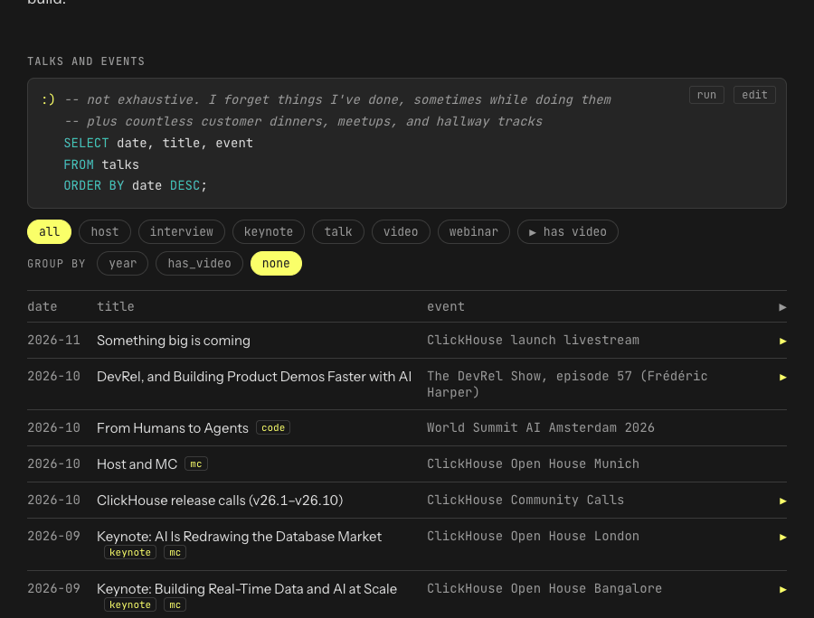

# tylerhannan.com

My site. It's a folder of HTML and JSON in `public/`, with no build step and no database of its own. Every query box on it is real SQL, and it runs on [play.clickhouse.com](https://clickhouse.com/docs/get-started/sample-datasets/playground), ClickHouse's public playground, with the site's data sent along as tables.

```
cd public && python3 -m http.server 8000   # the site, minus search by meaning
npx wrangler dev                           # the site, with search
```

Pushing to `main` deploys it to Cloudflare Workers. The only server code is `src/worker.js`, which embeds whatever you type into the search box.

## The query boxes

The playground has a read-only `play` user with no password, and it takes requests from any website. So `public/run.js` is mostly one `fetch()`. The playground won't store my data, so the data comes along with the query: `run.js` turns each table you mention into a `values()` CTE and puts it in front of your SQL.

```sql
WITH talks AS (SELECT * FROM values('date Date, title String, …', (…), (…)))
SELECT toYear(date) AS year, count() FROM talks GROUP BY year
```

The tables are `talks`, `demos`, `photos`, `posts` (the old blog), `writing` (posts I wrote elsewhere) and `pages` (all of it). The playground's own tables work too. Give a box `data-run` and it gets a run button.



## Search

Search by meaning is `cosineDistance` over vectors from [`aiEmbed`](https://clickhouse.com/docs/reference/functions/regular-functions/ai-functions). `python3 scripts/embed.py` makes them in `clickhouse local` with EmbeddingGemma 2 through Ollama, keeps 384 of the 768 dimensions as Int8, and writes `public/embeddings.json`. Re-run it after adding anything. Your search words go through the same model on Workers AI (`/api/embed`). The browser ranks the results itself, and when you press run, the playground returns the same rows.

There's a budget, though. Every search sends the whole `pages` table, and the playground takes at most 256 KB per query. It's about 208 KB today. If a query is too big, `run.js` says so instead of sending it.

Setup, once: `brew install ollama && brew services start ollama && ollama pull embeddinggemma-2:270m-bf16-text`, then ClickHouse from [clickhousectl](https://clickhouse.com/docs/concepts/features/interfaces/cli).

## Editing the data

I don't hand-edit the JSON. `scripts/ch` is a tiny clickhouse-client for it:

```sql
INSERT INTO talks (date, title, event, location, type, url, youtube)
VALUES ('2026-11-04', 'Kill Your Dashboards', 'Some Conf 2026', 'Paris, FR', 'talk', 'https://someconf.io', NULL);
UPDATE photos SET camera = 'Rolleiflex 2.8e' WHERE place ILIKE '%singapore%';
```

It checks edits against the schema (`DESCRIBE talks`) and rewrites the file. `SELECT` runs on the playground with your local files, so you can check before you push. `node scripts/check-pages.mjs` makes sure it and the browser agree.

## Photos

Export from Lightroom as sRGB JPEG, 2000 px or more, with Remove Location Info ticked. Then:

```
scripts/add-photo.sh ~/Pictures/Export/IMG_1234.jpg "Title" "Place" "YYYY-MM"
```

It resizes, makes a thumbnail, and strips the metadata (no GPS, no serial numbers). Write the `alt` text yourself: photo search only knows what it says.

## The old blog

The WordPress posts still live at their old addresses, as plain HTML. I converted them once and deleted the importer, since keeping a parser for a hacked database around seemed like more trouble than it was worth. The footer on every page comes from `scripts/footer.html`: edit it, then run `python3 scripts/footer.py`.

## License

The code is [MIT](LICENSE). Borrow whatever's useful. The photos, posts, and data are mine, all rights reserved, and images in old posts that came from elsewhere belong to their owners. Colours are [Selenized](https://github.com/jan-warchol/selenized) by Jan Warchoł.
