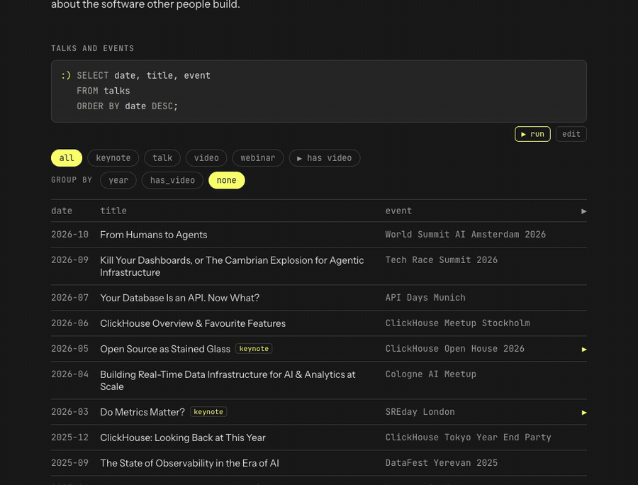

# tylerhannan.com

Static site, no build step. Everything served lives in `public/`. Hosted on Cloudflare Workers (`wrangler.jsonc`); every push to `main` deploys.

Preview locally (pages fetch JSON, so opening the files directly won't work):

```
cd public && python3 -m http.server 8000
```

## Adding photos

Export from Lightroom with:

| Setting | Value |
|---|---|
| Format | JPEG, quality 90+ |
| Color space | sRGB |
| Size | Long edge 2000 px or larger (don't enlarge) |
| Metadata | Copyright only, **Remove Location Info** checked |

Then add each one:

```
scripts/add-photo.sh ~/Pictures/Export/IMG_1234.jpg "Title" "Place" "YYYY-MM"
```

The script shrinks the long edge to 2000 px (smaller photos stay as they are), removes GPS location data, saves it as `public/photos/<title>.jpg`, and adds it to the top of `public/photos.json`. Commit and push to publish.

- The script strips location data (EXIF GPS and Lightroom's XMP), but ticking "Remove Location Info" in Lightroom is still a good habit. Other metadata, like camera and copyright, is kept.
- The grid crops every photo to a 4:3 landscape box. The full-size viewer shows the whole photo. If the crop cuts off the subject, add `"focus": "top"` (or `bottom`, `left`, `right`) to that photo in `photos.json`.
- Titles become filenames, so a repeated title overwrites the earlier photo.
- Optional fields in `photos.json`: `camera` (shown in the viewer caption) and `alt` (a short description for screen readers; the title is used if empty).

## Talks

Edit `public/talks.json`. Each talk has `date`, `title`, `event`, `location`, `type` (keynote / talk / webinar / video / podcast / host, for MC and host slots), `url`, `youtube` (the 11-character video ID, or `null`), and optionally `note` and `repo` (a public GitHub repo for the talk, shown as a "code ↗" link). To show a talk in **Highlighted videos** on the home page, give it `"highlight": 1` to `6` (the number sets its position).

## Runnable queries

The query boxes on the home, photos, archive and 404 pages run on real ClickHouse. Click **▶ run** to execute the query, or **edit** to change it first (⌘/Ctrl+Enter runs it while editing).



ClickHouse accepts SQL over plain HTTP, so `public/run.js` sends each query from the browser with a single `fetch()`: a POST to `https://play.clickhouse.com/?user=play` with the SQL as the body. `play` is the public [ClickHouse playground](https://play.clickhouse.com)'s read-only user and needs no password. The playground allows requests from any website (`Access-Control-Allow-Origin: *`), so there is no server of our own in between. Before sending a query, `run.js` does this:

- The site's data is sent along with each query as inline tables, so `talks`, `photos`, `posts` and `pages` work like real tables. For example, a query that mentions `talks` is sent as `WITH talks AS (SELECT * FROM values(...)) <your query>`.
- Anything else on the playground works too, such as `SHOW TABLES` or its demo datasets like `uk_price_paid`.
- Each query is wrapped in `SELECT * FROM (...) LIMIT 501 FORMAT JSONCompact`, and at most 500 rows are shown.
- Errors come back from ClickHouse as they are, minus the long list of expected tokens on syntax errors.

The `play` user can't change settings, read from URLs, use `format()`, or create temporary tables, so the inline data uses `values()`. Every query shown on the site has to be valid ClickHouse SQL, which is why the grouped talks views use `groupArray()`. To make a new query box runnable, give it `data-run` (`<div class="query" data-run>`) and load `/run.js` on the page. `DESCRIBE tyler` stays decorative.
