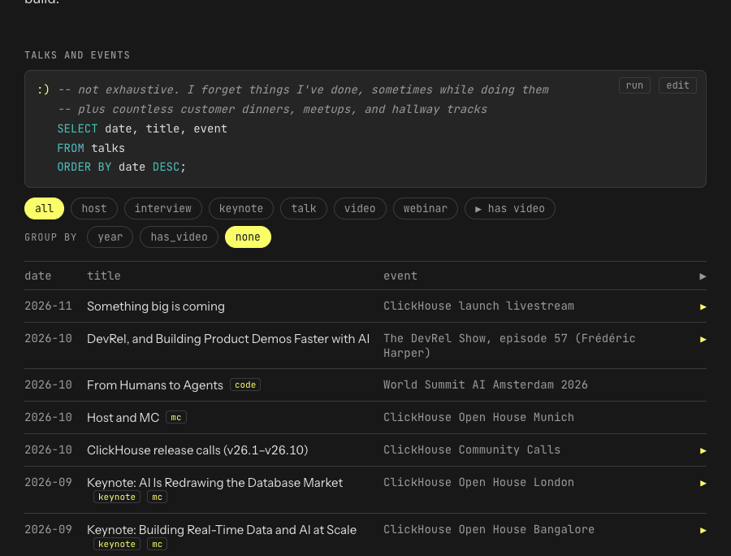

# tylerhannan.com

Static site, no build step. Everything served lives in `public/`. Hosted on Cloudflare Workers (`wrangler.jsonc`); every push to `main` deploys. The one bit of server code is `src/worker.js`, which serves `/api/embed` for the 404 page (see [Embeddings](#embeddings)).

Preview locally (pages fetch JSON, so opening the files directly won't work):

```
cd public && python3 -m http.server 8000
```

## Adding photos

Export from Lightroom with:

| Setting | Value |
|---|---|
| Format | JPEG, quality 90+ |
| Color space | sRGB |
| Size | Long edge 2000 px or larger (don't enlarge) |
| Metadata | Copyright only, **Remove Location Info** checked |

Then add each one:

```
scripts/add-photo.sh ~/Pictures/Export/IMG_1234.jpg "Title" "Place" "YYYY-MM"
```

The script shrinks the long edge to 2000 px (smaller photos stay as they are), makes a 600 px thumbnail for the grid, strips the metadata, saves them as `public/photos/<title>.jpg` and `public/photos/thumbs/<title>.jpg`, and adds the photo to the top of `public/photos.json`. The date is required, as `YYYY-MM`. Commit and push to publish.

- `scripts/strip_metadata.py` keeps only the pixels, the colour profile and the orientation. GPS, place names (EXIF, XMP and IPTC), camera and lens serial numbers, owner and copyright all go, so fill in `camera` in `photos.json` if you want it shown. Ticking "Remove Location Info" in Lightroom is still a good habit.
- The grid crops every photo to a 4:3 landscape box. The full-size viewer shows the whole photo. If the crop cuts off the subject, add `"focus": "top"` (or `bottom`, `left`, `right`) to that photo in `photos.json`.
- Titles become filenames; the script refuses a title whose file already exists.
- Optional fields in `photos.json`: `camera` (shown in the viewer caption) and `alt` (a short description for screen readers; the title is used if empty).

## Talks

Edit `public/talks.json`. Each talk has `date`, `title`, `event`, `location`, `type` (keynote / talk / webinar / video / podcast / host, for MC and host slots), `url`, `youtube` (the 11-character video ID, or `null`), and optionally `note`, `mc` (`true` adds an "mc" tag for events Tyler also hosted) and `repo` (a public GitHub repo for the talk, shown as a "code ↗" link). To show a talk in **Highlighted videos** on the home page, give it `"highlight": 1` to `6` (the number sets its position).

## Demos

Edit `public/demos.json`. Each demo has `date`, `name`, `about` (one line), `event` (or `null`, e.g. for client work that can't be named) and `repo`. They show in the **Demos** section on the home page, newest first. A talk with a demo also gets `repo` in `talks.json`, which adds a "code" tag to its row.

## Editing data with SQL

`scripts/ch` is a tiny clickhouse-client for the site's JSON files, so you never hand-edit them:

```sh
scripts/ch                       # interactive: tylerhannan.com :) prompt, end statements with ;
scripts/ch "DESCRIBE talks"      # one-off
scripts/ch < changes.sql         # from a file
```

```sql
INSERT INTO talks (date, title, event, location, type, url, youtube)
VALUES ('2026-11-04', 'Kill Your Dashboards', 'Some Conf 2026', 'Paris, FR', 'talk', 'https://someconf.io', NULL);

ALTER TABLE talks UPDATE youtube = 'https://youtu.be/…' WHERE title = 'Kill Your Dashboards';
UPDATE photos SET camera = 'Rolleiflex 2.8e' WHERE place ILIKE '%singapore%';
DELETE FROM demos WHERE name = 'Thing';

SELECT date, title FROM talks WHERE youtube IS NULL ORDER BY date DESC LIMIT 5;
```

`INSERT`, `UPDATE` and `DELETE` rewrite `talks.json`, `demos.json` or `photos.json` in place, after checking each value against the table's schema (`DESCRIBE talks` shows it): dates, talk types, URLs, YouTube IDs (a full YouTube URL is accepted), unique highlight slots. Errors come back ClickHouse style (`Code: 16. DB::Exception: There is no column titel in table talks. Maybe you meant title?`). New rows go in date order without reshuffling the rest. `SELECT` (and anything else) runs on play.clickhouse.com with your local files sent along as tables, the same way the site's run buttons work, so you can check an edit before pushing. Photos are `UPDATE` only: add them with `scripts/add-photo.sh`. Nothing is committed; review with `git diff`, then commit and push.

## Runnable queries

The query boxes on the home, photos, archive, post and 404 pages run on real ClickHouse. Click **▶ run** to execute the query, or **edit** to change it first (⌘/Ctrl+Enter runs it while editing).



ClickHouse accepts SQL over plain HTTP, so `public/run.js` sends each query from the browser with a single `fetch()`: a POST to `https://play.clickhouse.com/?user=play` with the SQL as the body. `play` is the public [ClickHouse playground](https://play.clickhouse.com)'s read-only user and needs no password. The playground allows requests from any website (`Access-Control-Allow-Origin: *`), so there is no server of our own in between. Before sending a query, `run.js` does this:

- The site's data is sent along with each query as inline tables, so `talks`, `photos`, `posts` and `pages` work like real tables. For example, a query that mentions `talks` is sent as `WITH talks AS (SELECT * FROM values(...)) <your query>`.
- Anything else on the playground works too, such as `SHOW TABLES` or its demo datasets like `uk_price_paid`.
- Each query is wrapped in `SELECT * FROM (...) LIMIT 501 FORMAT JSONCompact`, and at most 500 rows are shown.
- Errors come back from ClickHouse as they are, minus the long list of expected tokens on syntax errors.

The `play` user can't change settings, read from URLs, use `format()`, or create temporary tables, so the inline data uses `values()`. Every query shown on the site has to be valid ClickHouse SQL, which is why the grouped talks views use `groupArray()`. To make a new query box runnable, give it `data-run` (`<div class="query" data-run>`) and load `/run.js` on the page. `DESCRIBE tyler` stays decorative.

## Embeddings

`/search/` searches everything (linked from the home page nav), the photos and archive pages search their own rows, each talk has a "more like this" link (`/search/?like=<path>`), the 404 page finds pages by meaning as well as spelling, and every old post ends with its nearest posts. Both are `cosineDistance` queries over embeddings, made like this:

- **Pages, ahead of time:** `python3 scripts/embed.py` collects every row of the `pages` table (home, photos, archive, posts with their text, talks, demos), plus every photo from its title, alt text and place, and embeds them with ClickHouse's [`aiEmbed`](https://clickhouse.com/docs/sql-reference/functions/ai-functions) in `clickhouse local`. It uses [EmbeddingGemma](https://ollama.com/library/embeddinggemma) running in Ollama, through Ollama's OpenAI-compatible endpoint, so it's free and nothing leaves your machine. It keeps the first 384 of the 768 dimensions (the model is trained so a prefix still works; 128 was too lossy for one-word searches), scales them to Int8, and writes `public/embeddings.json` (about 150 KB). In the same run, ClickHouse works out each post's nearest posts, and the script writes them into the post pages and `public/archive/related.json`, which the importer reads on a re-import. It takes a few seconds. Run it again after adding posts or talks: a page without a vector gets zeros and sorts last.
- **The search, live:** `public/search.js` (the search page, photos, archive and the 404 page) calls `/api/embed?q=<words>`. `src/worker.js` embeds them with the same model on Cloudflare Workers AI (`@cf/google/embeddinggemma-300m`), truncates and scales them the same way, and caches the answer for a day. Input is capped at 200 characters.
- **The query:** `run.js` sends the vectors as base64 strings and unpacks them into an `embedding Array(Float32)` column on `posts` and `pages`, so the whole site's vectors stay well inside the playground's 256 KB query limit. The live vector is a one-row `request` table. Each page shows the result computed the same way in the browser, so it appears without a round trip, and ▶ run gets the same rows from ClickHouse. `?q=some+words` on any page with a search box searches on load. Talks and demos have no pages of their own, so in `pages` their `path` is their row on the home page (`/#talk-<date>-<event>`, `/#demo-<name>`, made by `siteAnchor` in `site.js`), which opens and highlights that row; results never send people off the site. A talk's "more like this" uses its stored vector, so it needs no live embedding. Photo search works only as well as the alt text in `photos.json`, so write a sentence about what's in each new photo.

Setup, once: `brew install ollama && brew services start ollama && ollama pull embeddinggemma`, then ClickHouse via [clickhousectl](https://clickhouse.com/docs/concepts/features/interfaces/cli) (`curl -fsSL https://clickhouse.com/cli | sh`, then `clickhousectl local use latest`). The Homebrew cask's binary is quarantined by macOS; clickhousectl's isn't.

## License

The code (HTML, CSS, JavaScript, `scripts/`, `src/`) is [MIT](LICENSE). Borrow whatever's useful.

The content isn't: the photos, the posts, and the talks, demos and writing data are © Tyler Hannan, all rights reserved. Images in old posts that came from elsewhere belong to their owners. Colours are [Selenized](https://github.com/jan-warchol/selenized) by Jan Warchoł (MIT).
